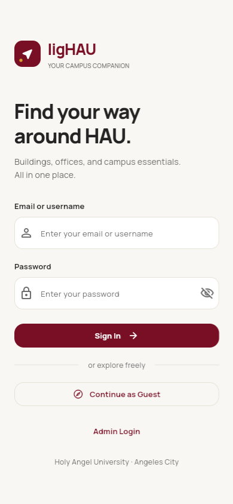
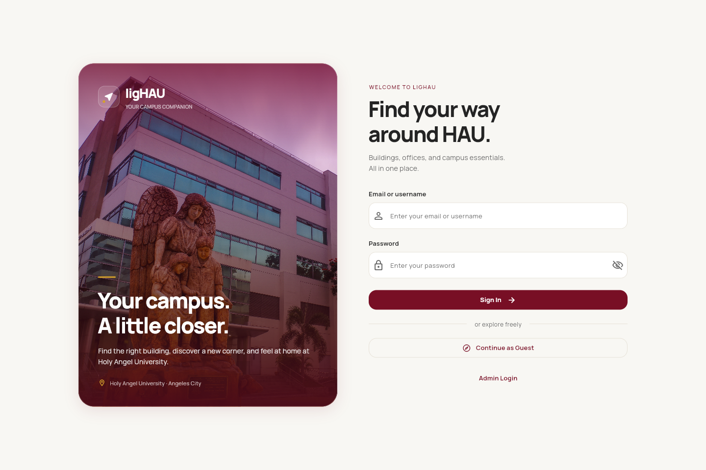
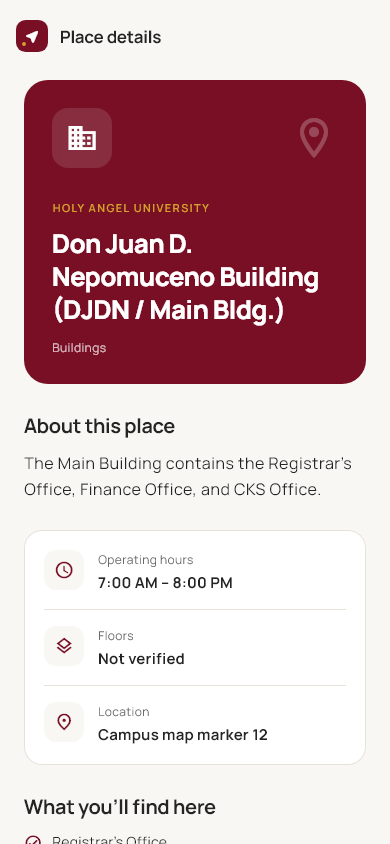

# ligHAU

[](AI-USAGE.md)


> Open source campus guide for Holy Angel University

ligHAU helps students and visitors find campus buildings, offices, and services through an interactive map, searchable directory, and campus assistant. Administrators maintain a shared catalog through a separate authenticated dashboard.

**Website:** https://ongods.github.io/ligHAU/

**Demo video:** [Demo recording](docs/05-demo-video.md)

**Course:** Applications Development and Emerging Technologies (6ADET), Holy Angel University

**Author:** Sean Keiffer S. Ong (`ongods`)

This is a public project repository. Local credentials and databases are ignored; the [security and privacy record](docs/06-security-and-privacy.md) documents data storage, service-side protections, and checklist evidence.

## What it does

- Explore campus outlines and selectable places on a 2D map with separate zoom/recenter controls, attribution, and selection information.
- Search 22 seeded campus records by keyword/category and open their details and listed services. Seventeen records match map geometry; five have an unverified-location state.
- Ask follow-up questions and compare multiple building matches through numbered cards with individual details/map actions.
- Sign in as an administrator to add, edit, and delete shared records with saved changes, conflict detection, and auditing.
- Monitor Gemini and map-provider usage from the administrator dashboard.
- Use the responsive welcome screen with a simple mobile brand header and desktop campus photo, plus responsive directory/chat layouts.

Guest browsing requires no account. The ordinary welcome sign-in is a prototype navigation flow, not student authentication. GPS routing, 3D buildings, reviews, and dedicated room or chatbot-knowledge editors are not implemented. Operating hours are prototype data; unknown floor counts and map positions remain explicitly unknown.

## Screenshots

The welcome screenshots show the current mobile brand header and desktop campus photo. The building-details image is an earlier implementation preview, before the October 11 panel refinements. The [design system](docs/03-design-system.md) describes current styling; the [mockup document](docs/02-mockup.md) contains the six submitted conceptual designs.

| Welcome on mobile | Welcome on desktop | Building details |
| --- | --- | --- |
|  |  |  |

## Built with

| Layer | Implementation |
| --- | --- |
| Frontend | Flutter Web / Dart, Material 3, bundled Manrope |
| State | `setState` and a shared `ValueNotifier` facility repository |
| Backend | Node.js HTTP API, packaged with Docker |
| Storage | SQLite locally; PostgreSQL support, including Supabase-hosted Postgres |
| Map | MapLibre, MapTiler tiles, and OpenStreetMap campus outlines |
| Packages | `http`, `maplibre_gl`, `latlong2`, `flutter_svg`, `url_launcher`; see [pubspec.yaml](pubspec.yaml) |

Flutter calls the Node API. The backend owns database access and Gemini credentials; the browser receives public map configuration and the backend origin.

## Running locally

Requires Flutter with Dart compatible with `^3.8.0`, Node.js 22.14 or newer, and npm. Docker Desktop's engine is needed only for Docker development and isolated PostgreSQL tests.

Run from the project root in PowerShell:

```powershell
flutter pub get
npm.cmd ci
# Only if .env does not already exist:
Copy-Item .env.example .env
```

Fill in `MAPTILER_KEY` and `GEMINI_API_KEY` privately, keep `CHAT_PORT=8787`, then run:

```powershell
./tools/run-web.ps1
```

The launcher creates browser-safe map configuration, reuses a healthy project backend or starts one on **8787**, and launches Chrome on **53923**. If the Flutter port is occupied, it stops without starting another app server. For changes, use `r` for hot reload or `R` for hot restart in the existing Flutter terminal. Quit with `q` before relaunching on the same port.

For separate terminals, configure the map and keep one backend running:

```powershell
./tools/sync-map-config.ps1
node --env-file=.env server/chat-server.mjs
```

Then, in the Flutter terminal:

```powershell
flutter run -d chrome --web-port 53923
```

Choose this manual setup or the launcher. Reuse existing project sessions and do not stop unrelated services to clear a port.

### Configuration

Copy [.env.example](.env.example) only when creating your local file. Never commit `.env` or pass the entire file to Flutter.

| Variable | Purpose | Visibility |
| --- | --- | --- |
| `MAPTILER_KEY` | Browser map delivery key; restrict allowed frontend origins | Browser-visible |
| `MAPTILER_STYLE_ID` | Map style, default `streets-v4` | Public |
| `CHAT_API_BASE_URL` | Hosted backend HTTPS origin, supplied as a Flutter dart define | Public |
| `GEMINI_API_KEY` | Generate campus chatbot responses | Backend only |
| `GEMINI_MODEL` | Backend model, default `gemini-3.5-flash-lite` | Backend setting |
| `CHAT_PORT` | Keep `8787` for local development | Backend setting |
| `DATABASE_DRIVER` | `sqlite` by default, or `postgres` | Backend setting |
| `CAMPUS_DB_PATH` | SQLite database path; default `server/.local/campus.sqlite` locally | Backend setting |
| `DATABASE_URL` | Restricted-role PostgreSQL connection string | Private, backend only |
| `DATABASE_MIGRATION_URL` | Schema-owner connection string for provisioning tools | Private, tooling only |
| `DATABASE_CA_FILE` | Path to the database CA certificate when required | Backend setting |
| `MAPTILER_SERVICE_TOKEN` | Optional provider-management token for usage monitoring | Private, backend only |

The map setup script writes ignored `assets/config/map.local.json` containing only the browser key/style. Rerun it and restart Flutter after changing those settings; the launcher does this automatically. Public deployment uses Flutter dart defines instead.

The current app uses direct PostgreSQL connections through Node; it does not require a Supabase browser key or Supabase Auth. The privacy record separately notes an unused privileged Supabase key found in ignored local configuration.

## Administrator access and shared data

No administrator is created by default, and there is no public registration endpoint. Create an individual account through an interactive terminal:

```powershell
node --env-file=.env server/manage-admin.mjs create YOUR_USERNAME
node --env-file=.env server/manage-admin.mjs list
node --env-file=.env server/manage-admin.mjs reset YOUR_USERNAME
node --env-file=.env server/manage-admin.mjs disable YOUR_USERNAME
```

Usernames contain 3–100 characters. Passwords contain 15–128 characters and are entered twice with typing hidden. The server stores salted scrypt hashes and verifies permissions on protected requests. Sessions expire after two hours; reset/disable revoke them. Logout clears the browser token immediately and attempts backend revocation, so an offline logout may leave the server session valid until expiry. Browser tokens stay in memory.

The catalog is seeded once from [mock_data.dart](lib/data/mock_data.dart). Subsequent administrator changes update the saved catalog used by map, directory, details, and Gemini. Active views poll approximately every 10 seconds and refresh when the app resumes. Failed refreshes identify sample or previously loaded data and offer Retry.

Record versions reject conflicting edits/deletions; HTTP 412 indicates a stale version and HTTP 428 a missing version. The app refreshes after a conflict so the administrator can reopen the record. Changes and their actor are saved together in the audit trail.

Existing buildings retain their source geometry when renamed. New records can supply paired latitude/longitude values for a selectable pin. Clearing both restores the original mapped position if one exists. Unknown positions are not invented.

### Campus assistant and usage

The Node backend sends Gemini the campus catalog, current question, and up to six previous question/answer pairs. Conversation history stays in app memory and is not saved as a transcript in application storage. Provider/hosting retention settings still require review.

Replies can show up to four recognized building matches. Each card opens the matching record or selects its map location; this is not turn-by-turn routing.

The administrator's **API usage & quota** page shows recorded provider requests/tokens, configured allowances, failures, and backend activity. Counts persist in the selected database; process HTTP metrics reset on restart. These are app-recorded totals, not a guarantee of the provider's remaining account quota.

Default chat limits are 5 questions per client IP per 10 minutes, 30 globally per 10 minutes, 100 per Pacific calendar day, and 5 per minute. Two provider calls may run at once; a bounded queue holds up to four waiting client IPs per process for up to five seconds. Provider quota failures trigger cooldown and Retry-After guidance. See [.env.example](.env.example) for limit/reference-quota settings.

MapTiler usage requires the separate private `MAPTILER_SERVICE_TOKEN`. Its backend result is cached for 60 seconds. Without that token, the monitoring UI links to the provider dashboard. Optional `MAPTILER_QUOTA_REQUESTS` and `MAPTILER_QUOTA_SESSIONS` are configured reference allowances.

## Backend storage and recovery

### SQLite

SQLite is the local default. Records, account hashes, sessions, audit history, and usage counters live in ignored `server/.local/campus.sqlite`. The backend enables transactions, WAL journaling, foreign keys, and synchronous commits. Production SQLite requires an explicit persistent `CAMPUS_DB_PATH`.

Keep one backend on a persistent local disk/volume and protect its database/backups. Multiple hosts should use a shared database service. Do not put this SQLite database on a network filesystem.

Create a snapshot using a new filename, then restore into a new database file when needed:

```powershell
node --env-file=.env server/backup.mjs backup server/.local/backups/campus-snapshot.sqlite
node --env-file=.env server/backup.mjs restore server/.local/backups/campus-snapshot.sqlite server/.local/restored.sqlite
```

The commands verify integrity and refuse existing destinations. Restore revokes saved sessions/provider leases. Stop only the verified project backend, set `CAMPUS_DB_PATH` to the restored file, restart on 8787, and check records, administrator access, usage, and an edit before retiring the original database. Backups contain password hashes and require restricted access.

### PostgreSQL / Supabase

The backend verifies TLS and requires the private `lighau` schema and restricted `lighau_backend` role. A failed PostgreSQL connection does not fall back to SQLite.

1. Apply the [private-schema migration](supabase/migrations/20261009150153_lighau_postgres.sql) once using a schema-owner SQL connection.
2. Set `DATABASE_MIGRATION_URL` privately and run `node --env-file=.env server/provision-postgres.mjs --apply` to assign the restricted role's password using the hidden prompt.
3. Set `DATABASE_DRIVER=postgres` and `DATABASE_URL` to that restricted-role connection. Configure `DATABASE_CA_FILE` when needed; keep hosted TLS verification enabled.
4. Run `npm.cmd run db:check` and review the connection, TLS, role, and schema output before starting the backend.

[import-sqlite.mjs](server/import-sqlite.mjs) supports importing existing local records; inspect its options before using it. Keep schema-owner credentials out of the running backend's host environment.

`npm.cmd run test:postgres` checks the migration, permissions, concurrency, authentication, quotas, persistence, import, and HTTP behavior against its own temporary Docker database. It does not use the hosted application database.

### Local Docker backend

Use Docker instead of a Node backend already occupying 8787:

```powershell
docker compose up --build -d backend
```

[compose.yaml](compose.yaml) binds port 8787 to loopback and persists SQLite in a named volume. For the configured PostgreSQL connection and certificate mount:

```powershell
docker compose -f compose.yaml -f compose.postgres.yaml up --build -d backend
```

Docker Desktop's engine must be running. Reuse the existing project backend rather than launching a duplicate.

## Deployment

[GitHub Actions](.github/workflows/deploy-web.yml) verifies the app, builds Flutter Web, and publishes static assets to GitHub Pages on `main` or manual dispatch.

- Set Pages to use GitHub Actions.
- Set repository secret `MAPTILER_KEY` and repository variable `CHAT_API_BASE_URL` to the hosted backend's HTTPS origin.
- The workflow uses the repository base path for Pages. The compiled map key remains browser-visible.
- Host [Dockerfile](Dockerfile) separately for Node; static Pages cannot run the API.
- Configure private backend credentials, `NODE_ENV=production`, `CHAT_ALLOWED_ORIGINS`, HTTPS, and trusted-proxy/platform settings for the actual backend host.
- Use a verified PostgreSQL setup or explicit persistent SQLite storage.

The packaging is implemented. Hosted map rendering, chatbot connectivity, restart persistence, and host/database permissions still need online validation.

## Verification

Run checks from the project root with dependencies installed and Docker's engine available for PostgreSQL:

```powershell
flutter analyze
flutter test
npm.cmd run test:backend
npm.cmd run test:postgres
node server/stress-test.mjs --soak-seconds=300
flutter build web --release
node tools/check-release-secrets.mjs
```

CI requires Flutter/backend checks, a 30-second isolated stress soak, and real PostgreSQL integration checks before publication. The stress tool uses a temporary SQLite database and simulated Gemini responses; it leaves live records and provider quota alone. [stress-results.json](docs/stress-results.json) contains retained local evidence, not hosted-capacity proof.

The **October 11 local checklist review** passed 22 targeted backend tests. Forty-one existing web-build files were checked against five configured private values without a leak. The real PostgreSQL suite was skipped because Docker's engine was stopped. This README update did not rerun Flutter, stress, or hosted checks; see [verification evidence](docs/06-security-and-privacy.md#existing-verification-coverage).

For a configured HTTPS staging environment, set `SMOKE_APP_URL`, `SMOKE_API_URL`, `SMOKE_ADMIN_USERNAME`, and `SMOKE_ADMIN_PASSWORD` privately, then use:

```powershell
node tools/staging-smoke.mjs --allow-staging-writes
node tools/staging-soak.mjs
```

The smoke test creates/edits/deletes a temporary staging record. Optional `--one-chat` makes one real Gemini request; `--browser` checks rendering when Playwright/Chrome are installed. The soak reads the catalog for five minutes at concurrency 10, expecting zero failed reads and p95 below one second. Verify hosted recovery and provider connectivity separately.

## Privacy and security

The backend stores administrator usernames/hashes, expiring sessions, campus records, audit history, and usage counters. Chat requests/context reach Gemini; map requests reach MapTiler. Private credentials belong in ignored local configuration or backend-host secrets. Public visitors can read catalog data; writes and usage monitoring require server authorization.

PostgreSQL uses private-schema grants and RLS for the backend role. The original [security checklist](docs/06-security-and-privacy.md#checklist) has four satisfied items and three unresolved items from the local review: a privileged key in ignored configuration, real PostgreSQL/RLS verification, and final-video privacy review. The demo folder is now linked, but its contents have not been reviewed in this session. No private credential was found in tracked files/history or the existing web build during the scoped scan.

## Project documentation

| Document | Contents | Status |
| --- | --- | --- |
| [Proposal](docs/01-proposal.md) | Problem, audience, MVP, persistence, risks, and implementation differences | Filled from the submitted PDF and source |
| [Mockup and wireframes](docs/02-mockup.md) | Six extracted conceptual screens, submitted/current flows, screen actions | Filled; concepts clearly labeled |
| [Design system](docs/03-design-system.md) | Palette, Manrope, spacing, components, photography, UI checks | Updated to the implementation |
| [Security and privacy](docs/06-security-and-privacy.md) | Storage, credentials, authorization/RLS, original checklist and evidence | Local review recorded; remaining checks documented |
| [AI usage](AI-USAGE.md) | Eight retrospective assistance entries, three correction cases, original frontend attribution | Filled with commit references |
| [Weekly reports](docs/04-weekly-reports.md) | Weekly progress and decisions | Template awaiting the author's entries |
| [Demo video](docs/05-demo-video.md) | Shared project demo folder | Linked; playback/privacy review pending |
| [Campus map data](docs/campus-map-data.md) | Sources, coverage, attribution, configuration | Supporting technical notes |

The Markdown documents preserve the submitted proposal and design context. Extracted mockup images are retained in `docs/assets/`.

## Status and next steps

The map, directory, authenticated catalog editing, Gemini assistant, usage monitoring, PostgreSQL support, and Docker/Pages packaging are implemented. The latest UI adds the supplied photo, complete map/chat borders, separated map controls, and clearer multiple-building replies.

The proposal, mockup, design system, security/privacy record, and AI-use log are filled out. The demo folder is linked. Remaining work is to complete weekly reports, review the recording, verify real PostgreSQL/RLS and live deployment, confirm campus metadata, and refresh older screenshot previews.

## Credits

- Flutter/Dart packages: [pubspec.yaml](pubspec.yaml) and [pubspec.lock](pubspec.lock).
- Node packages/Supabase CLI: [package.json](package.json) and [package-lock.json](package-lock.json).
- Campus outlines: OpenStreetMap contributors, ODbL 1.0; see [map-data notes](docs/campus-map-data.md).
- Map tiles: MapTiler; attribution is displayed in the map.
- Manrope: SIL Open Font License; see [OFL.txt](assets/fonts/OFL.txt).
- Welcome photograph: supplied by the project author; see [campus-welcome.jpg](assets/branding/campus-welcome.jpg).

## AI use

I built the initial Flutter frontend scaffolding, shared controls, basic button behavior, and navigation in the September 29–October 2 commits. Codex/ChatGPT assisted with later map/backend integration, responsive design, debugging, deployment preparation, tests, and documentation. [AI-USAGE.md](AI-USAGE.md) records the original contributions, eight retrospective assistance entries, and three correction cases with commit evidence. Current files contain original and later AI-assisted work.

## Licence

Application code: MIT, see [LICENSE](LICENSE). Map data and fonts retain their separate licenses described above.
