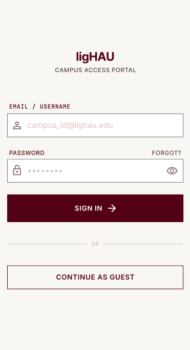
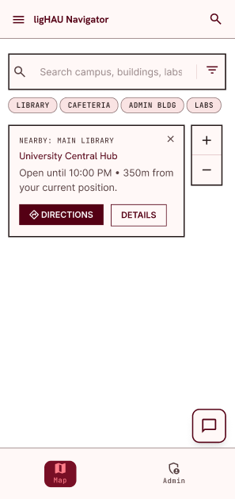
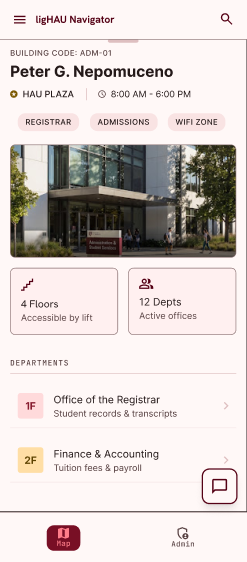
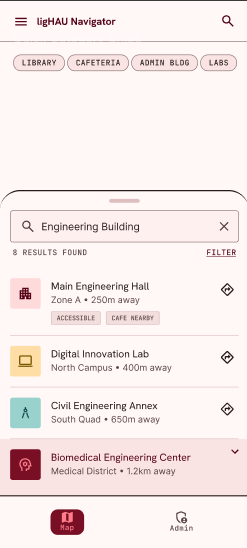
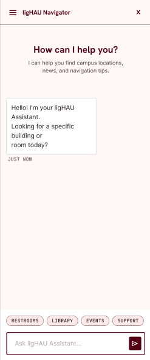
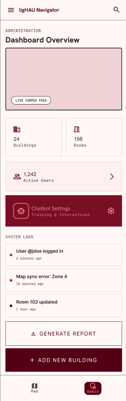
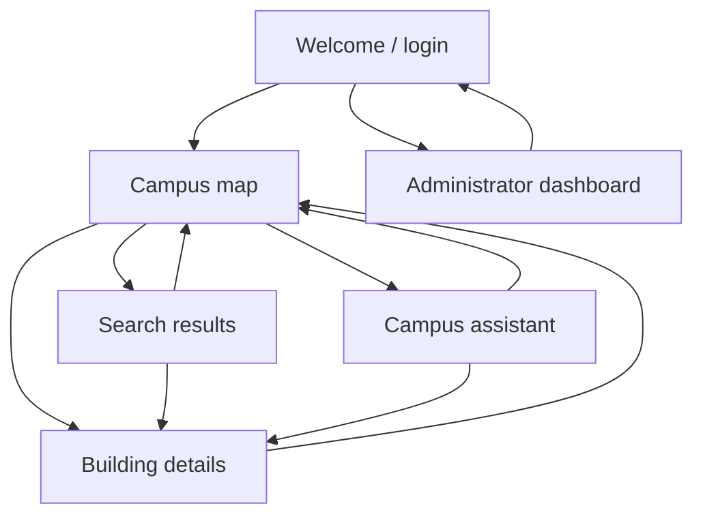
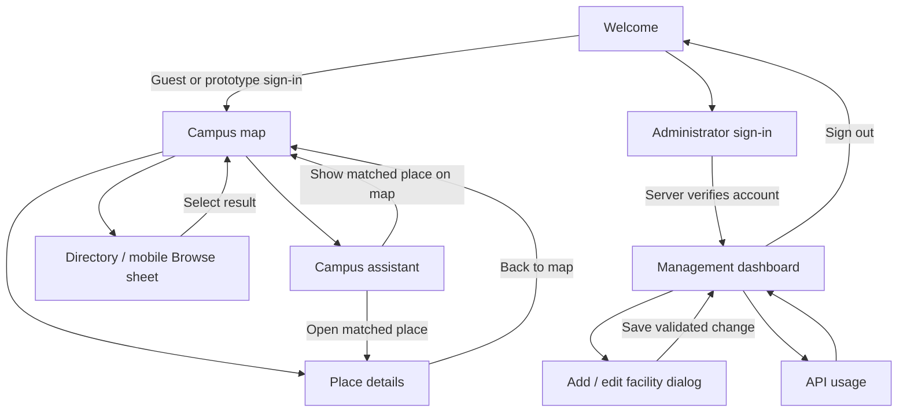

# Mockup and wireframes

**Project:** ligHAU · **Author:** Ong, Sean Keiffer S. · **Section:** CS-302

**Submitted mockup:** September 20, 2026 · **Documentation updated:** October 11, 2026

Source: [Final Mockup](<Ong - Final Mockup.pdf>), pages 1–10. The six images below were extracted from that PDF. They show the **submitted visual concept**, not screenshots of the current app. Building metadata, distances, hours, account names, and dashboard totals shown in the mockups are illustrative, not verified campus or usage data.

## Mockup

### 1. Welcome and login

**PDF pages 1–2.** A cream background, burgundy ligHAU wordmark, labeled account fields, password visibility control, primary sign-in button, and guest option introduce the app. The submitted concept also includes password recovery.

**Current design:** the welcome page pairs the supplied campus photo with “Your campus. A little closer.” A burgundy gradient supports white text, a gold accent ties the photo to the theme, and rounded framing gives it the same visual language as the form. Desktop uses two columns; mobile places the photo above a scrollable form. Guest access opens the map, and a separate administrator action opens real admin authentication. Ordinary sign-in is a prototype; password recovery is not implemented.

### 2. Campus map

**PDF pages 2–3.** Search, category chips, a selected-building card, zoom controls, floating chatbot access, and Map/Admin navigation surround the campus map. The concept suggests proximity information and a Directions action.

**Current design:** desktop places the directory beside the map; mobile uses inline search, filters, and a Browse sheet. Zoom and recenter controls sit in the map header, attribution has its own footer, and selected-place information sits below the canvas. A shared frame keeps all four edges visible. The assistant opens from the header. Distances from a live visitor position and route calculation are not implemented.

### 3. Building details

**PDF pages 4–5.** A building title, code, photograph, hours, service chips, floor information, and department list provide detail after a map selection. Accessibility and department counts in the concept are sample claims.

**Current design:** a dedicated page shows catalog-backed name, category, location, description, hours, optional floor count, and service list. “Back to map” returns to map selection. Unverified accessibility badges and claims of a highlighted route are omitted. Unknown values remain unknown; the app does not provide a verified room-by-room floor plan.

### 4. Search results

**PDF pages 5–6.** A search field, result count, building cards, category/location context, and map actions support finding a specific place. Sample distance and accessibility labels illustrate the proposed card hierarchy.

**Current design:** keyword search and category filtering work within the map directory, with wrapping names and clear selection states. A separate `SearchScreen` is also implemented. Results lead to facility details or map selection; no visitor-distance calculation is performed.

### 5. Campus assistant

**PDF pages 6–7.** A titled chat panel contains an introductory message, suggestion chips, conversation bubbles, text input, send control, and close action.

**Current design:** the assistant is a dedicated page with a complete rounded border, inner gutters, scrollable conversation, and keyboard-aware input. Responses are selectable. When a reply identifies several buildings, numbered match cards show each place's name, location, description, and separate details/map actions. Loading and error messages explain request states. The pictured Restrooms/Library/Events/Support quick-action chips are not implemented.

### 6. Administrator dashboard

**PDF pages 7–8.** The concept shows summary totals, recent activity, chatbot settings, report generation, and an Add Building action.

**Current design:** a separate sign-in protects the management dashboard. Administrators can search the catalog, add or edit facility records, delete records, and inspect API usage. The backend verifies permission for each protected request. Registered-user management, general report generation, and a chatbot knowledge/settings editor shown in the concept are not implemented. Mockup counts and example activity are not production statistics.

## Wireframes

The supplied PDF discusses changes from earlier box-and-label wireframes on pages 8–10, but does not include those earlier sketches. The screen flow below documents the submitted navigation plan without inventing missing wireframe images.

### Submitted screen flow

### Implemented screen flow

## Screens

| Screen or surface | Main content | User action and destination |
| --- | --- | --- |
| Welcome | Campus photograph, brand, account fields, guest/admin access | Guest or completed prototype fields → public map; administrator access → admin sign-in. |
| Campus map | Search, categories, directory, canvas, map controls, selected place | Select a result or outline → place selection; details → details page; assistant → chat page; Browse → mobile directory sheet. |
| Building details | Catalog description, location, hours, floors when known, services | Back to map → selected place on the map, when its position is available. |
| Search | Query and matching catalog cards | Open details or choose a place on the map. Primary browsing also provides inline search. |
| Campus assistant | Conversation, request state, input, matched-building cards | Send → backend reply; details → matched record; map → matched place; back → map. |
| Administrator sign-in | Username, password, validation/error feedback | Valid server authentication → dashboard; back → welcome. |
| Management dashboard | Catalog search/list, add/edit/delete controls, usage access | Add/edit → editor; delete → confirmation; usage → API usage page; sign out → welcome. |
| API usage | Backend provider usage and budget information | Refresh statistics or return to management. |

## Design changes and review points

The PDF's revision replaces rough screen boxes with a consistent burgundy/gold palette, explicit control labels, category chips, richer building cards, conversation styling, and a more structured administrator dashboard. The [design system](03-design-system.md) records how that direction is implemented today.

Current UI checks focus on full panel borders, text wrapping, multiple chatbot matches, visible map attribution, clear missing-location states, and controls that do not cover the map canvas. Widget tests cover narrow and wide layouts, enlarged text, a short map viewport, and the chat keyboard. These checks do not certify the conceptual mockups' sample data or full accessibility compliance.
